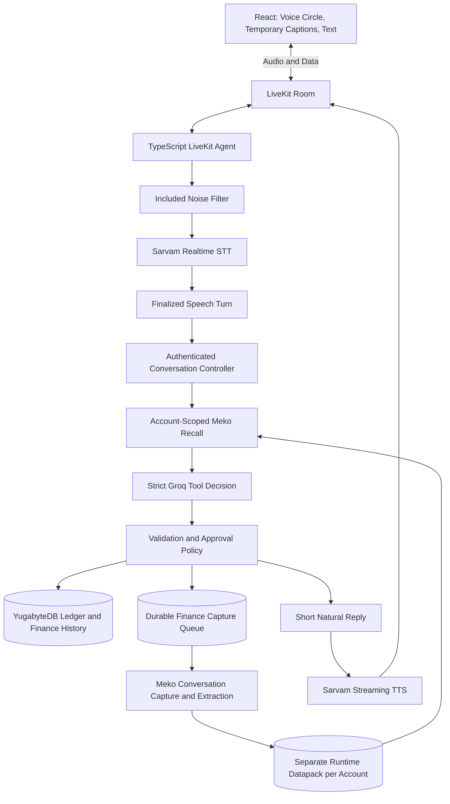

# munim

Munim is a voice-first financial operator for Indian shopkeepers. Speak or type a money movement, answer a short question if needed, and save it under your chosen approval policy. English and Hindi apply throughout the UI; Hindi-English code-switching is accepted in speech.

YugabyteDB is the financial source of truth. Meko remembers shop terminology and conventions across conversations. Recalled context never establishes a payment, amount, price, or authorization.

## Run Locally

Use Node.js 22+ and the pinned pnpm version in `package.json`. Have a development YugabyteDB YSQL database available. For a **new development database**, setup takes four commands:

```sh
cp .env.example .env
pnpm install
pnpm setup:local
pnpm dev:all
```

Edit `.env` before `setup:local`. It builds contracts, initializes the ledger schema, runs additive migrations, and downloads voice resources. `db:push` inside this command is for initial development setup. Upgrade an existing database with `pnpm db:migrate` instead.

Web: `http://localhost:5173`. API: `http://localhost:3001`. `pnpm dev:all` starts API, web, and the persistent voice worker together. Alternatively use `pnpm dev` for API/web and `pnpm voice:dev` in another terminal. Restart the voice worker after source/config changes; it does not hot-reload.

### Configuration

| Purpose | Variables |
| --- | --- |
| Database | `DATABASE_URL` |
| Google-only sign-in | `BETTER_AUTH_URL`, `BETTER_AUTH_SECRET`, `GOOGLE_CLIENT_ID`, `GOOGLE_CLIENT_SECRET` |
| Realtime transport | `LIVEKIT_URL`, `LIVEKIT_API_KEY`, `LIVEKIT_API_SECRET` |
| Speech | `SARVAM_API_KEY`; optional model/persona settings in `.env.example` |
| Interpretation | `GROQ_API_KEY`, optional `MUNIM_LLM_MODEL` |
| Business memory | `MEKO_API_KEY`, `MEKO_PROVISIONING_DATAPACK_ID` (or existing `MEKO_DATAPACK_ID` as bootstrap only), optional `MEKO_MCP_URL` |
| Payment links | Razorpay **test-mode** keys and `RAZORPAY_WEBHOOK_SECRET` |

Register `http://localhost:5173/api/auth/callback/google` as Google's development redirect URI. In production use the HTTPS app origin and corresponding callback. Serve `/api` on the same origin as the frontend. No password login, owner-email allowlist, or auth bypass is included.

Secrets stay server-side; never use `VITE_` variables for provider keys or commit `.env`. Each signed-in account owns its ledger and preferences through the immutable Better Auth user ID. Prototype ledger data stays separate. `MUNIM_BUSINESS_ID` still restricts the prototype Razorpay integration; it no longer grants access to another shop's memory.

## Agent Architecture



LiveKit Agents manages audio lifecycle, speech detection, interruption handling, worker processes, and playback. Munim's Hono backend orchestrates interpretation, recalled context, validation, and financial writes. The worker uses completed speech turns; speculative ledger actions remain disabled.

Code defaults are Sarvam `saaras:v4` STT, Groq `openai/gpt-oss-120b`, and Sarvam `bulbul:v4-flash` TTS. Environment settings can override them. These are integration defaults, not benchmark winners for shop audio. Groq reasoning defaults to `low`; the reasoning budget, completion limit, and timeout are configurable.

The model has two strict tools: `propose_transaction` and `reply_to_user`. Memory retrieval happens before the decision, rather than requiring another model turn to request it. Tool schemas require explicit values or null for unknowns; runtime validation remains authoritative. The model cannot write the ledger, verify payment, change settings, or send money.

See [the detailed architecture](docs/architecture.md) for ownership, persistence, and recovery boundaries.

## Record Transaction

Only Voice and Text are available. The circular control connects, cancels a connection attempt, or ends the call. A pill beside it shows temporary STT and reply previews; activity dots run only during communication. Pause/Resume and red End controls appear when connected. Full **finance history** and secondary entry details are expandable. Partial captions are provisional and never authorize saving; they may change as recognition finalizes. Reply text is not word-synchronized audio.

Onboarding has separate Language, Shop Name, and Saving Preference screens with no preselected choices. All three persist per account and remain editable in Settings. The shop name appears in navigation and the overview heading. Existing accounts missing a name complete that step without losing saved language/saving choices. The opening greeting follows the selected language; speaking another language does not overwrite that preference.

The public homepage at `/` explains Munim and includes a clearly labelled interactive example using the real record-summary component. The example is local and never accesses the microphone, calls speech/model providers, or writes records. Start Your Khata opens `/record`, using Google sign-in and onboarding as needed. The homepage is English/Hindi, follows the saved light/dark theme, and does not load authentication or voice code until entering the app.

App screens have their own routes: `/overview`, `/record`, `/transactions`, `/insights`, `/business-memory`, `/conversations`, and `/settings`. Navigation supports direct links, reloads, and browser Back/Forward. Static production hosting must serve `index.html` for these frontend paths, while routing `/api/*` to the API.

- **Ask for Approval:** a complete draft waits for exact-revision confirmation. Spoken approval requires successful, uninterrupted playback of the actual financial review. A greeting or ordinary reply cannot mark a review complete. On-screen confirmation is also supported.
- **Full Autonomy:** complete validated new entries save immediately. Missing material facts get one short question. Changing a setting or reconnecting never saves an existing draft.

Payment status needs matching evidence in the current utterance when introduced or changed. The backend derives direction for known transaction kinds, validates integer paise, requires a counterparty for credit, and commits entries and part-payment settlements atomically. Stable request/entry identities prevent duplicate writes from retries.

Only exchanges classified as finance-related are appended to conversation history and queued for Meko. Greetings such as hello/hi use a fast path and remain transient. Finance questions, shop-convention teaching, current-draft corrections, and confirmations can be retained. This is application intent filtering, not a complete abuse/content guardrail system.

The model receives the current draft and up to eight prior finance messages; active state retains up to 60. Active conversation capabilities expire after 12 hours. A separate account-scoped archive keeps finance messages for read-only access through **Past Conversations** at `/conversations`; existing locally retained histories are imported by migration, but previously deleted histories cannot be recovered. Leaving the recording page ends the session; returning or reloading starts a fresh conversation. Voice stays open until ended or an unrecoverable failure occurs; temporary disconnects trigger bounded reconnection. Leaving voice disconnects microphone and audio.

New records include English and Hindi display copies of descriptions and counterparty names. Descriptions are translated; proper names are transliterated. Changing the app language switches these display copies in record cards, transactions and Insights. Original fields and transcript/spoken messages remain unchanged. Legacy records without display copies fall back to their original fields. Text and archived conversations use familiar left/right bubbles and timestamps; Enter sends and Shift+Enter adds a line.

Raw microphone audio and LiveKit session recording are disabled. Finalized finance text is stored locally and eligible exchanges are sent to Meko; provider retention policies still apply.

## Three Runtime Memory Uses

1. **Datapack isolation:** a server-owned SQL mapping associates each authenticated account with its own runtime Meko datapack. Deterministic hashed names, owned-name reconciliation, and leases make provisioning retryable. Clients cannot select another account or datapack.
2. **Extracted memories:** committed finance exchanges enter a durable outbox. A background worker sends them through Meko's conversation API, which extracts durable facts asynchronously. Provider conversation/message identifiers are stable across retries. Successful queue rows clear their text payloads. Failed updates are visible and retryable in Business Memory. Ledger writes do not wait for extraction.
3. **Recall before reasoning:** the backend retrieves actual shop facts before asking Groq to interpret a turn. The runtime path uses a bounded recent-memory window, selects up to five relevant facts, and labels its limited coverage. Business Memory provides deeper semantic search. An unavailable source is distinct from a successful empty result.

Expand **Shop Context** under an entry to inspect actual recalled facts. IDs claimed by the model must be in the returned set. Correct/Forget actions operate on verified account-owned memories and invalidate affected unsaved drafts and reviews. Stored conversations are not treated as a fallback source for forgotten facts. Promotion and cross-shop sharing are excluded.

The bootstrap datapack contains only empty administrative provisioning traces, never customer finance exchanges. Runtime account packs are separate from the team's coding/build datapack. All remote access is performed by the server's Meko account: application-level account mapping is enforced by Munim, not by forwarding end-user Google tokens to Meko. Credential compromise and operator access remain production considerations.

Set `MUNIM_MEMORY_ENABLED=false` and restart API to compare the same finalized input with memory off. This disables recall and capture; it does not delete existing memories. Use separate recording conversations with identical current facts, and inspect real returned context rather than fabricated examples. Extraction is asynchronous; wait for a convention to appear before the later-session demonstration.

The hackathon's shared coding-agent build datapack, Check T, judge access, five-minute demo, and Meko feature proposal are separate submission requirements. This runtime implementation does not automatically satisfy them.

## Latency and Production Controls

| Area | Current Implementation | Still Needs Live Evidence |
| --- | --- | --- |
| Measurement | Correlated STT/backend/recall/Groq/TTS/playback timings; token/cache usage; authenticated process-local p50/p95 summary at `/api/voice-metrics` | Acoustic end-to-end latency and concurrent-shop measurements |
| Turn completion | Configurable STT silence and LiveKit endpoint delay; baseline 600 ms + 100 ms | Hindi pauses, quiet speech, and false-cutoff tradeoff |
| Model output | Strict tool calling, bounded retries, low reasoning, bounded context/output, stable cacheable prompt prefix | Representative accuracy comparison across reasoning/model choices |
| Input quality | Browser suppression/echo cancellation plus included LiveKit environmental filter; recognized word required for interruption | Actual noisy shop and nearby-speaker scenarios |
| Output quality | Brief replies, one synthesis request across sentences, streaming 20 ms PCM, no replay retry after partial speech | Naturalness, interruption recovery, names and amount pronunciation |
| Operations | Prewarmed VAD/filter, warm workers, load-based job capacity, API concurrency cap, readiness, draining, bounded provider work, durable memory queue | Deployment, region selection, provider quotas, load and failure drills |

`client_audio_gap` measures browser-observed local-speaker end to remote-speaker activity. It is a transport/activity proxy, not a calibrated microphone-to-speaker measurement. API summaries are per-account, in-memory, bounded to recent samples, and reset when that process restarts; worker metrics are structured logs. No raw text/audio is logged by these timing events.

The endpointing baseline reduces configured waiting from the previous 800+200 ms. It is not a measured speedup. A small live structured-output check accepted the same credit sale with low and medium reasoning; that sample does not establish a faster or more accurate model setting.

The agent-side VAD and Sarvam endpoint controls are independently configurable. The included defaults favor filtering short background bursts (`MUNIM_VAD_ACTIVATION_THRESHOLD=0.65`, `MUNIM_VAD_MIN_SPEECH_MS=350`), while keeping ordinary turns responsive. They are starting points, not validated shop-noise settings; tune them from observed latency and error patterns without storing raw audio.

Live semantic memory search was materially slower than the voice budget in a small validation. The voice path therefore uses Meko's recent-memory window rather than claiming complete semantic recall on every turn. A recent-window miss does not prove an older memory does not exist. Tune `MUNIM_MEMORY_RECALL_TIMEOUT_MS` for your measured deployment.

## Deploy

Build with `pnpm build`. Run the API with `pnpm start`, serve `apps/web/dist` with same-origin `/api` routing, and run the persistent worker separately with `pnpm voice:start`. Do not put the voice worker in a short-lived request function. `MUNIM_API_URL` must be reachable from it. Microphone capture requires HTTPS or localhost.

API readiness is `GET /readyz`; it checks database reachability. LiveKit's worker has its own SDK health endpoint (normally production port 8081). SIGTERM/SIGINT stop new API work and drain the memory worker before closing the database. Worker drain and warm capacity are configurable. `MUNIM_VOICE_MAX_JOBS` is a load-based target; managed LiveKit can override custom load functions, so deployment capacity must also be configured there.

Choose worker/API/database regions using actual network measurements. Ensure Groq, Sarvam, Meko datapack/retrieval quotas and LiveKit capacity cover simultaneous shops. No paid provider fallback or voice-isolation add-on is enabled automatically.

## Other Screens and Payments

Transactions provides search, settlement filters, and pagination over its explicitly loaded subset. Insights reads the full account ledger, compares settlement-based money movement, and shows remaining amounts. Entry age is not an invented due date; no profit, bank-balance, or forecasting claims are made.

Razorpay is **Test Mode only**. Expose `POST /api/webhooks/razorpay` through a public HTTPS endpoint and subscribe to `payment_link.paid`. Only verified signed events settle linked requests; unrelated QR/cash/bank payments are not verified. Live keys remain rejected. Per-shop production payment onboarding is not implemented.

## What Remains

- Browser/mobile and real microphone validation, including noisy shops, interruptions, script changes, and Hindi/English voice naturalness.
- Representative financial accuracy scoring and measured p50/p95 latency, throughput, capacity and provider-limit failure drills; no general performance guarantee is claimed.
- Production deployment, regional placement, monitoring retention/export, quotas, and end-user privacy/consent controls appropriate to launch.
- Historical ledger questions through voice, applying a payment to an older due, saved-entry corrections/reversals, and record-session restoration after refresh.
- Production Razorpay onboarding/reconciliation and outbound reminders.
- Full abuse/content guardrails and deeper memory lifecycle/retention controls. Promotion and shared staff knowledge are intentionally outside this change.
- Hackathon build-datapack evidence, judge invitation, feature proposal, and final live on/off demo.

## Verification

`pnpm build` checks all four packages. No automated test suite or test files are included. Manual provider checks use synthetic shop context and do not create financial records. See [CHANGELOG.md](CHANGELOG.md) for changes. A build or successful provider call does not establish live browser behavior, speech accuracy, latency, or deployment health.
