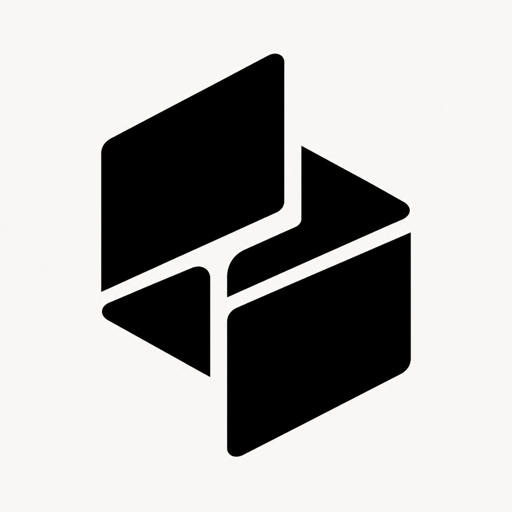
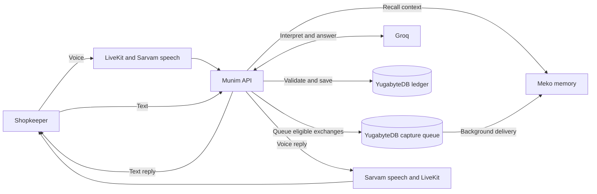

<p align="center">
  
</p>

<h1 align="center">munim</h1>

<p align="center">A voice-first financial assistant for Indian shopkeepers.</p>


## Problem statement

Shopkeepers need to record sales, purchases, expenses, and credit while serving customers. Manual bookkeeping interrupts that work, and scattered notes make outstanding balances difficult to track. A useful assistant also needs to remember the shop's familiar names and terminology across conversations.

## Our solution

Munim turns spoken or typed conversations into bookkeeping entries. It remembers shop conventions across conversations, keeps the original words intact, and lets shopkeepers choose whether to approve each entry or save complete entries automatically. The app supports English, Hindi, and mixed Hindi-English speech.

YugabyteDB stores the ledger and calculates balances. Meko supplies remembered shop context, with controls to inspect, correct, or forget it.

## Presentation

**Google Slides or PowerPoint link:**

<!-- Add your presentation link here. -->

## Team Rajdhani

| Name | Role |
| --- | --- |
| Atharva Verma | Team leader |
| Mohit Sharma | Team member |
| Siddharth Puhan | Team member |

## Features

- **Record by voice or text:** Describe a sale, purchase, expense, or other transaction. Munim asks for missing details and prepares a validated entry.
- **Understand the ledger:** Search transactions and ask about recorded activity or outstanding balances. Insights shows payment movement and dues by person.
- **Remember the shop:** Meko recalls shop terminology and conventions. Business Memory lets users inspect, search, correct, or forget returned facts.
- **Keep control of saving:** Ask for Approval requires a reviewed confirmation. Full Autonomy saves complete, validated proposals directly.
- **Work in your language:** Use the app in English or Hindi, while retaining original transaction descriptions and conversation text.
- **Review past conversations:** Browse saved finance conversations without reopening a draft or changing the ledger.

YugabyteDB holds the financial ledger. Meko provides context, never proof of a payment, amount, or authorization.

## How it works



The API retrieves bounded shop context before interpretation. Groq proposes an action or a read; the backend validates it, applies the account's saving policy, and writes the ledger. Eligible exchanges are sent to Meko in the background. Each account has its own runtime datapack.

See [architecture](docs/architecture.md) for the voice, memory, and approval flows.

## Tech stack

| Layer | Technology | Role in Munim |
| --- | --- | --- |
| Web app | React, Vite, React Router, Tailwind CSS v4 | Responsive screens, navigation, and English/Hindi interface |
| Backend | Node.js, TypeScript, Hono | Conversation orchestration, account-scoped reads, and validated financial writes |
| Data access | Drizzle ORM, `pg`, Zod | SQL queries, database schema, and shared request/response validation |
| Database | YugabyteDB YSQL | Financial records, authentication, conversation state, and durable memory jobs |
| Memory | Meko over MCP | Persistent shop context, recall, and memory management |
| Voice | LiveKit Agents, Silero VAD, Sarvam | Realtime audio, speech boundaries, transcription, and spoken replies |
| Reasoning | Groq | Structured replies, transaction proposals, and requests for authorized data reads |
| Authentication | Better Auth with Google | Sign-in and account ownership |
| Workspace | pnpm | Shared contracts and builds across the web, API, and voice packages |

## Why YugabyteDB and Meko

### YugabyteDB: financial records and durable state

Bookkeeping needs exact totals and reliable writes. Munim uses YSQL transactions to save each ledger entry and its initial settlement together. SQL calculates money received, money paid, and remaining balances from recorded transactions and settlements.

YugabyteDB also stores authentication records, account preferences, draft revisions, finance conversation history, and the queue for pending Meko updates. The queue survives API restarts and lets memory delivery run outside financial transactions.

The [database schema](apps/api/src/db/schema.ts) defines the records. The [ledger service](apps/api/src/services/ledger.ts) writes entries and settlements, while the [Insights service](apps/api/src/services/insights.ts) calculates payment movement and outstanding balances.

### Meko: shop context across conversations

A ledger records amounts, but a shopkeeper also uses familiar names and shorthand. Meko keeps that context available across conversations so the Agent can interpret later messages with relevant shop knowledge.

Munim retrieves recent facts before reasoning and uses semantic search for explicit memory questions. Eligible finance exchanges go through Meko's conversation extraction; taught conventions use explicit memory additions. Business Memory and Shop Context expose returned facts and support correction or forgetting. Each authenticated account maps to a separate runtime datapack.

The [shop-memory service](apps/api/src/services/shop-memory.ts) handles recall, capture, and account mapping through the [Meko MCP client](apps/api/src/services/meko.ts). The [interpreter](apps/api/src/services/interpreter.ts) supplies retrieved context to Groq. Amounts, payment status, and approval still come from validated current input and the ledger.

## Run locally

Use Node.js 22+, the pnpm version pinned in `package.json`, and a **new development YugabyteDB database**. Set up your provider credentials before running the setup command.

```sh
cp .env.example .env
pnpm install
pnpm setup:local
pnpm dev:all
```

After the first command, edit `.env`. The required settings are:

| Service | Variables |
| --- | --- |
| YugabyteDB | `DATABASE_URL` |
| Google sign-in | `BETTER_AUTH_URL`, `BETTER_AUTH_SECRET`, `GOOGLE_CLIENT_ID`, `GOOGLE_CLIENT_SECRET` |
| LiveKit | `LIVEKIT_URL`, `LIVEKIT_API_KEY`, `LIVEKIT_API_SECRET` |
| Sarvam and Groq | `SARVAM_API_KEY`, `GROQ_API_KEY` |
| Meko | `MEKO_API_KEY` and `MEKO_PROVISIONING_DATAPACK_ID` or `MEKO_DATAPACK_ID` |

Register `http://localhost:5173/api/auth/callback/google` in Google Cloud. Open [localhost:5173](http://localhost:5173); the API runs on port `3001`. The setup command initializes the schema and downloads voice resources. It includes `db:push`, so use it only with a new development database. For an existing database, use `pnpm db:migrate` instead.

Keep provider keys server-side and never commit `.env`. In production, serve the website and `/api` from the same HTTPS origin. Voice also requires a persistent worker, a reachable `MUNIM_API_URL`, and microphone permission.

## Future scope

- Apply payments to existing outstanding balances.
- Correct or reverse saved entries with a clear audit trail.
- Restore unfinished drafts across sessions.
- Improve mobile and offline support.
- Validate voice accuracy and reliability in real shop environments.

## Verification

- `pnpm build` builds the contracts, API, voice worker, and web app.
- `pnpm --filter @munim/api test` runs focused regression tests. The dues test uses temporary tables and skips without `DATABASE_URL`.
