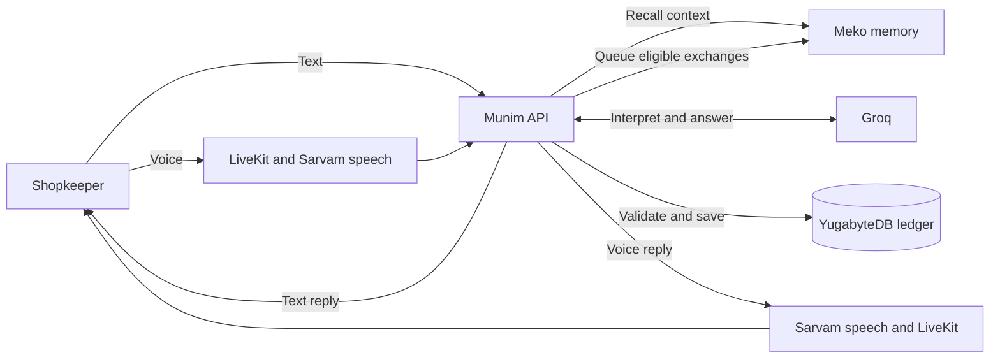

<p align="center">
  
</p>

<h1 align="center">munim</h1>

<p align="center">A voice-first financial assistant for Indian shopkeepers.</p>

Munim turns spoken or typed conversations into bookkeeping entries. It remembers shop conventions across conversations, keeps the original words intact, and lets shopkeepers choose whether to approve each entry or save complete entries automatically. The app supports English, Hindi, and mixed Hindi-English speech.

## What it does

- **Record by voice or text:** Describe a sale, purchase, expense, or other transaction. Munim asks for missing details and prepares a validated entry.
- **Understand the ledger:** Search transactions and ask about recorded activity or outstanding balances. Insights shows payment movement and dues by person.
- **Remember the shop:** Meko recalls shop terminology and conventions. Business Memory lets users inspect, search, correct, or forget returned facts.
- **Keep control of saving:** Ask for Approval requires a reviewed confirmation. Full Autonomy saves complete, validated proposals directly.

YugabyteDB holds the financial ledger. Meko provides context, never proof of a payment, amount, or authorization.

## How it works



The API retrieves bounded shop context before interpretation. Groq proposes an action or a read; the backend validates it, applies the account's saving policy, and writes the ledger. Eligible exchanges are sent to Meko in the background. Each account has its own runtime datapack, separate from the team's build datapack.

See [architecture](docs/architecture.md) for the voice, memory, and approval flows.

## Run locally

Use Node.js 22+, the pnpm version pinned in `package.json`, and a **new development YugabyteDB database**. Set up your provider credentials before running the setup command.

```sh
cp .env.example .env
pnpm install
pnpm setup:local
pnpm dev:all
```

After the first command, edit `.env`. The required settings are:

| Service | Variables |
| --- | --- |
| YugabyteDB | `DATABASE_URL` |
| Google sign-in | `BETTER_AUTH_URL`, `BETTER_AUTH_SECRET`, `GOOGLE_CLIENT_ID`, `GOOGLE_CLIENT_SECRET` |
| LiveKit | `LIVEKIT_URL`, `LIVEKIT_API_KEY`, `LIVEKIT_API_SECRET` |
| Sarvam and Groq | `SARVAM_API_KEY`, `GROQ_API_KEY` |
| Meko | `MEKO_API_KEY` and `MEKO_PROVISIONING_DATAPACK_ID` or `MEKO_DATAPACK_ID` |

Register `http://localhost:5173/api/auth/callback/google` in Google Cloud. Open [localhost:5173](http://localhost:5173); the API runs on port `3001`. The setup command initializes the schema and downloads voice resources. It includes `db:push`, so use it only with a new development database. For an existing database, use `pnpm db:migrate` instead.

Keep provider keys server-side and never commit `.env`. In production, serve the website and `/api` from the same HTTPS origin. Voice also requires a persistent worker, a reachable `MUNIM_API_URL`, and microphone permission.

## Hackathon demo

1. Add a shop convention in **Business Memory** and wait until it appears as a returned Meko fact.
2. Run the same conversation with memory enabled and disabled. Compare the actual recalled context and results; do not assume they differ.
3. Record an entry with an explicit amount and payment status. Show the review or save, the transaction, and its outstanding balance.
4. Show **Shop Context**, then correct or forget a saved convention.

Set `MUNIM_MEMORY_ENABLED=false` and restart the API for the memory-off run. Disabling memory does not delete saved facts. See the [demo plan and Meko feature proposal](docs/hackathon-demo.md) for the full five-minute story and submission checklist.

## Verification and limitations

- `pnpm build` builds the contracts, API, voice worker, and web app.
- `pnpm --filter @munim/api test` runs focused regression tests. The dues test uses temporary tables and skips without `DATABASE_URL`.
- Meko delivery does not guarantee that a durable fact was extracted. Recent-memory recall is a bounded window.
- Applying a payment to an older due, editing or reversing saved entries, and restoring a draft after refresh are not implemented.
- Live voice quality, noisy-shop performance, and a production deployment have not been validated.
